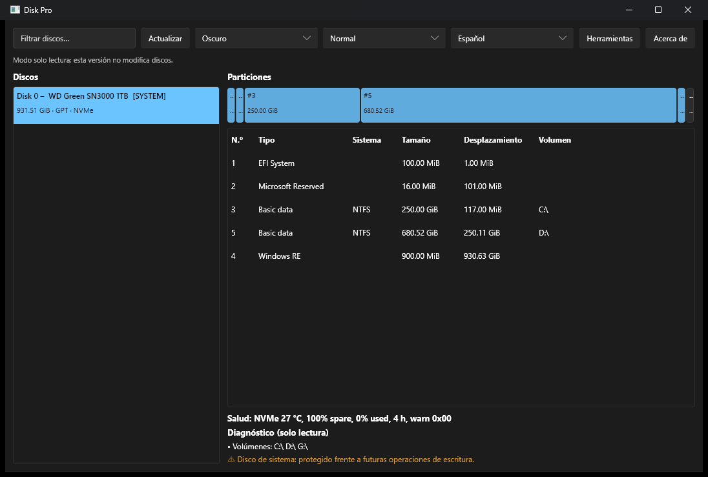
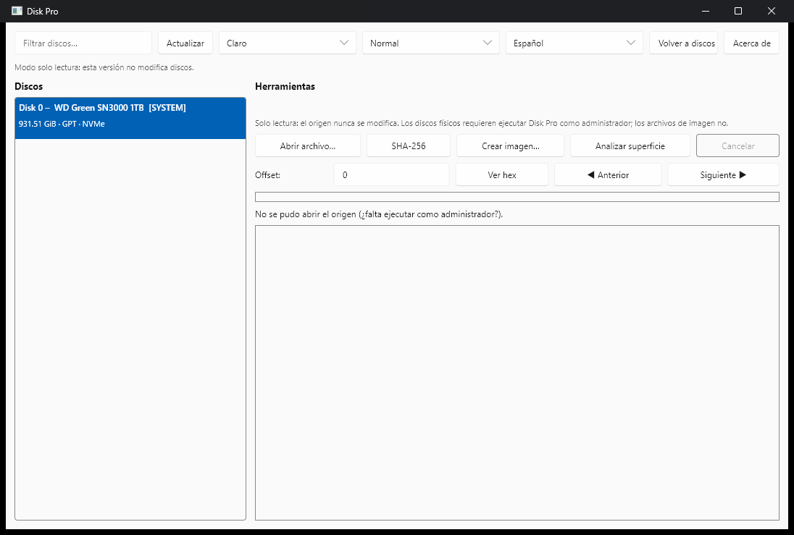
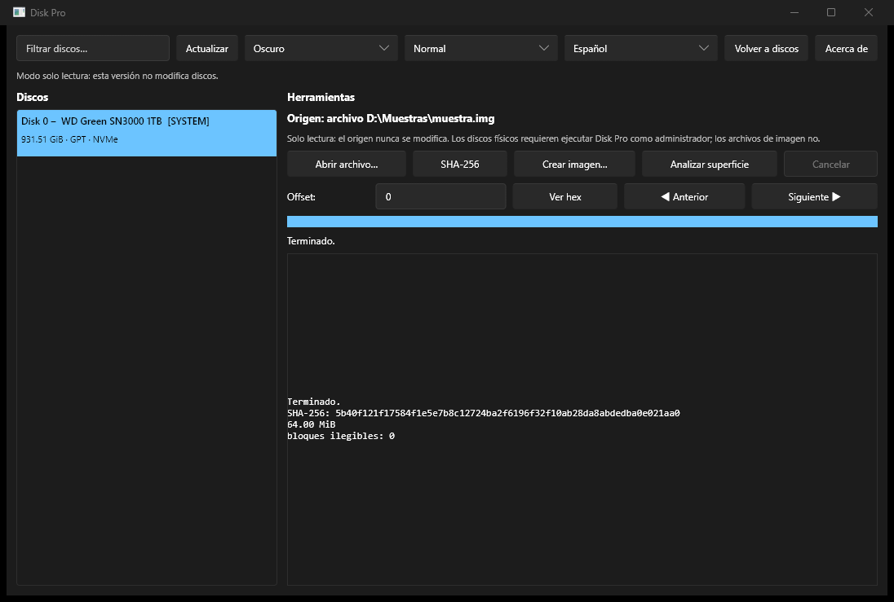
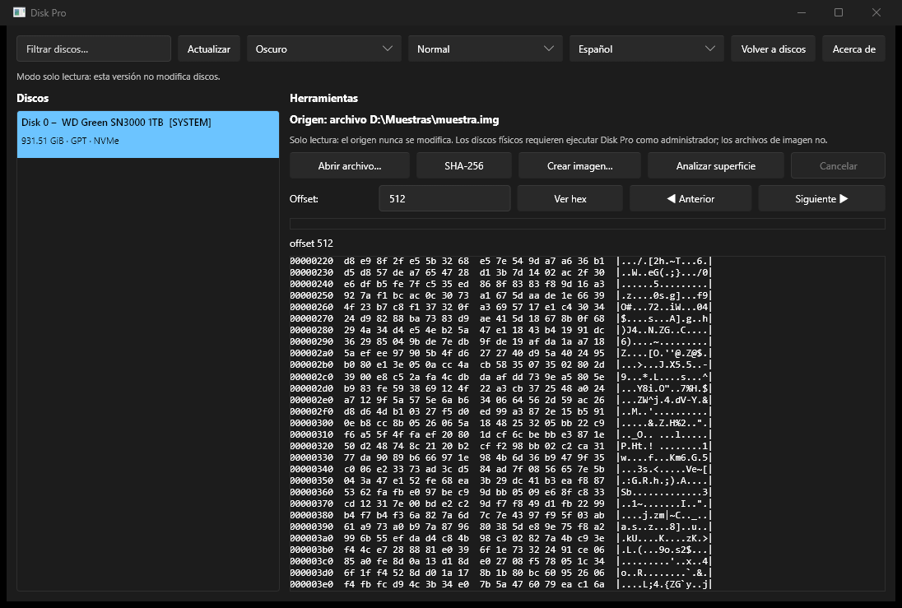
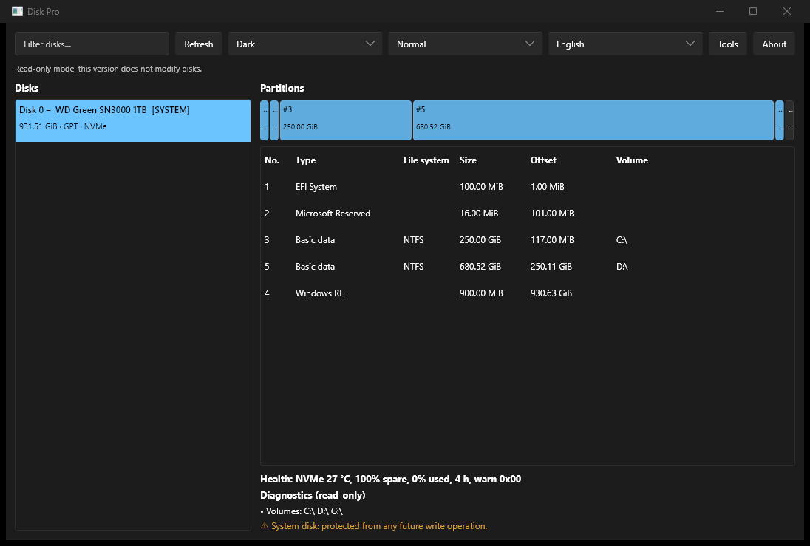

<div align="center">

# Disk Pro

### Un inspector de discos y particiones gratuito, de código abierto y para Windows.

[](#requisitos)
[](#compilar-desde-el-código)
[](https://slint.dev)
[](LICENSE)
[](#estado-y-límites)
[](#datos-y-privacidad)

**Mira tus discos. Entiende tus particiones. Sin tocar nada.**

[Descargar para Windows](https://github.com/GonzaloCN-Dev/disk-pro/releases/latest) ·
[Funciones](#funciones) · [Instalar](#instalación) · [Informar de un problema](https://github.com/GonzaloCN-Dev/disk-pro/issues)

</div>

Disk Pro es una aplicación de escritorio en español e inglés para inspeccionar discos físicos y virtuales, sus tablas de particiones y su salud. Está escrita en C++ con Slint: sin Electron, sin WebView y sin servidores. Desarrollado por **Gonzalo Cruz Núñez** ([GCN Dev](https://dev.gonzalocn.com/)).

> **Estado: 0.6.0.** Lee discos y, **solo en discos virtuales (VHD) de hasta 4 GiB**, restaura tablas, clona, edita la tabla de particiones y formatea FAT32/exFAT. Busca particiones perdidas y recupera de forma limitada archivos borrados FAT32 hacia otro destino. No formatea NTFS, no mueve datos al redimensionar y no escribe en discos físicos: no se simula. Consulta [Estado y límites](#estado-y-límites).

*EN – Disk Pro is a free, open-source, native Windows disk inspector (GPT/MBR, partitions, NVMe/ATA health, imaging, hex viewer). Version 0.6.0 reads any disk; writing (restore, clone, partition-table edits, FAT32/exFAT format) is limited to virtual disks of up to 4 GiB. Lost-partition search and limited FAT32 deleted-file recovery are read-only on the source. No NTFS formatting, no physical-disk writes.*

## Capturas

| Discos y particiones (oscuro) | Tema claro |
| --- | --- |
|  |  |

| Herramientas: SHA-256 | Herramientas: visor hexadecimal |
| --- | --- |
|  |  |

| Interfaz en inglés |
| --- |
|  |

## Funciones

| Función | Qué puedes hacer |
| --- | --- |
| **Inventario de discos** | Discos físicos y virtuales con modelo, tamaño, bus (NVMe, SATA, USB…), tabla GPT/MBR, tamaño de sector, letras de unidad, sistema de archivos y espacio libre/total del volumen cuando Windows lo expone. Marca el disco del sistema. El número de serie se muestra enmascarado. |
| **Mapa de particiones** | Barra gráfica con particiones y espacio libre, y tabla de particiones. |
| **Diagnóstico** | Detecta solapes, rangos fuera del disco, desalineación y errores de CRC en GPT. |
| **Salud** | Datos NVMe (temperatura, reserva, desgaste, horas, apagados inseguros y errores) y atributos ATA SMART habituales (temperatura, horas, sectores reasignados, pendientes y no corregibles) cuando el controlador los expone. |
| **SHA-256** | Hash de un disco o de un archivo de imagen, con progreso y cancelación. |
| **Crear imagen** | Copia un disco o archivo a una imagen. Nunca sobrescribe un archivo existente; los bloques ilegibles se rellenan con ceros y se cuentan. |
| **Copia de la tabla de particiones** | Guarda el primer y último MiB del disco (MBR/GPT y copia de seguridad GPT) en un archivo `.ptb` con SHA-256, y `diskpro-tools ptverify` comprueba su integridad. Se restaura con `diskpro-restore` (ver abajo). |
| **Restaurar tabla (solo VHD)** | `diskpro-restore copia.ptb N` muestra una vista previa; para aplicar hay que escribir `--confirm "RESTORE DISK N"`. Bloquea el disco de sistema, discos no virtuales, de más de 4 GiB, de otro tamaño o con letras montadas, y verifica releyendo. Solo toca el primer y último MiB. Necesita administrador. |
| **Clonar (solo VHD)** | `diskpro-clone --disk N --to M` (o `--image archivo`) y página Herramientas: vista previa, texto de confirmación `CLONE TO DISK M`, barra de progreso, cancelar y verificación releyendo. Solo escribe en discos virtuales de hasta 4 GiB, nunca en el de sistema. Necesita administrador. |
| **Editar tabla (solo VHD)** | `diskpro-part --disk N init-mbr/init-gpt/create/delete/settype/setactive/resize/merge`, menú de clic derecho y campos de la página Herramientas: vista previa, confirmación `EDIT DISK N` y verificación releyendo. Solo toca la tabla, nunca el sistema de archivos (redimensionar y fusionar NO ajustan los datos). Solo primarias en MBR. **Formatear FAT32 y exFAT** con `diskpro-part --disk N format --index I --fs fat32|exfat`: formato rápido, confirmación `FORMAT DISK N PARTITION I`; NTFS no está. Al formatear bloquea y desmonta solo el volumen de esa partición. Solo VHD de hasta 4 GiB. Necesita administrador. |
| **Plan de particiones** | Arrastra el borde de una partición para redimensionar o su cuerpo para mover: solo **vista previa**, no cambia ningún disco. |
| **Análisis de superficie** | Lee todo el origen en solo lectura y lista los bloques ilegibles y la velocidad. |
| **Visor hexadecimal** | Navega por offset y por sectores, con columna ASCII. |
| **Análisis de imágenes** | `diskpro-cli imagen.vhd` analiza MBR/GPT en un archivo (512 y 4096 bytes por sector, pie de VHD fijo). |
| **Discos virtuales** | `diskpro-vhd create archivo.vhdx --size-mib N [--dynamic]` crea VHD/VHDX sin sobrescribir; `attach` conecta sin letra y en solo lectura por defecto (`--read-write` es explícito), y `detach` desconecta. |
| **Recuperación de archivos FAT32** | `diskpro-tools files` enumera candidatos borrados en directorios accesibles y `extract` los copia a un archivo nuevo en otro destino, tras revalidar entrada y clústeres. Nunca escribe en el origen. |
| **Ajustes y actualizaciones** | Busca nuevas versiones, las descarga y las instala desde Ajustes. La búsqueda al iniciar está desactivada por defecto. Solo hace una petición HTTPS a GitHub; el instalador se verifica con SHA-256 antes de ejecutarse. |
| **Interfaz** | Tema claro, oscuro o del sistema; español e inglés; tres densidades; navegación con teclado; sin bloquear la ventana mientras se lee. |

Leer discos físicos con las herramientas requiere ejecutar Disk Pro como administrador. El inventario no lo necesita.

## Estado y límites

- **No incluido todavía:** aplicar el redimensionado o movimiento de particiones (la barra solo prepara una vista previa); restaurar y clonar en discos físicos; recuperación de archivos NTFS/exFAT o de directorios FAT32 borrados; convertir discos virtuales; formatear NTFS; decodificación completa de atributos ATA SMART específicos de cada fabricante.
- La búsqueda de particiones perdidas reconoce estructuras NTFS/FAT32/exFAT y es de solo lectura. La recuperación FAT32 actual se limita a entradas borradas en directorios todavía accesibles y nombres cortos 8.3; consulta la documentación específica.
- **Probado:** pruebas unitarias con imágenes sintéticas (GPT, MBR, 512/4096, corrupción, errores de lectura inyectados), SHA-256 con vectores conocidos, y pruebas con un VHD desechable (GPT y MBR), incluida la restauración de la tabla y el bloqueo del disco de sistema.
- **Sin probar:** conexión/desconexión elevada de VHDX y operaciones de tabla sobre VHDX, sectores de 4096 bytes en dispositivos reales, y las herramientas de imagen/superficie sobre un disco físico. La creación de VHDX desechable sí tiene prueba automática.
- El instalador **no está firmado**: Windows SmartScreen puede avisar. Comprueba el SHA-256 de la descarga.

## Requisitos

Windows 10 u 11 de 64 bits. El instalador incluye el runtime de Visual C++; el zip portable requiere el [Visual C++ Redistributable x64](https://aka.ms/vs/17/release/vc_redist.x64.exe).

## Instalación

Descarga `DiskPro-Setup-0.6.0.exe` (instalador, por usuario, sin administrador) o `DiskPro-0.6.0-win64-portable.zip` desde [Releases](https://github.com/GonzaloCN-Dev/disk-pro/releases/latest). Los hashes están en `SHA256SUMS.txt`.

## Compilar desde el código

Requisitos: Visual Studio 2022 Build Tools (C++, CMake, Ninja) y el SDK C++ de Slint 1.19.1 en `.tools\slint`.

```
build.cmd      # compila y ejecuta las pruebas
package.cmd    # genera el zip portable con la versión de CMake
powershell -File installer\build-installer.ps1   # instalador (requiere Inno Setup 6)
```

Pruebas con VHD (PowerShell **como administrador**; `tests\vhdx\run_all.ps1` y `tests\vhdx\run_restore_all.ps1` y `tests\vhdx\run_clone_all.ps1`; solo usa un VHD desechable en `%TEMP%` y se niega a tocar otros discos):
`powershell -ExecutionPolicy Bypass -File tests\vhdx\run_all.ps1`

Arquitectura: [`docs/ARCHITECTURE.md`](docs/ARCHITECTURE.md).
Hoja de ruta: [`ROADMAP.md`](ROADMAP.md).
Compatibilidad: [`docs/COMPATIBILITY.md`](docs/COMPATIBILITY.md).
Formato de imágenes: [`docs/IMAGE_FORMAT.md`](docs/IMAGE_FORMAT.md).
Recuperación de archivos: [`docs/FILE_RECOVERY.md`](docs/FILE_RECOVERY.md).

## Datos y privacidad

Sin telemetría ni cuentas. Solo se conecta a Internet si pulsas «Buscar actualizaciones» (o activas la búsqueda al iniciar): una petición HTTPS a github.com sin enviar datos tuyos. Los ajustes (tema, idioma, densidad) se guardan en `%APPDATA%\DiskPro\settings.ini`.

## Licencia

Código propio bajo licencia MIT ([`LICENSE`](LICENSE)). Slint se usa bajo su licencia Royalty-free 2.0 y no queda cubierto por la MIT: consulta [`THIRD_PARTY_NOTICES.md`](THIRD_PARTY_NOTICES.md). Proyecto independiente, sin afiliación con otros gestores de discos.


